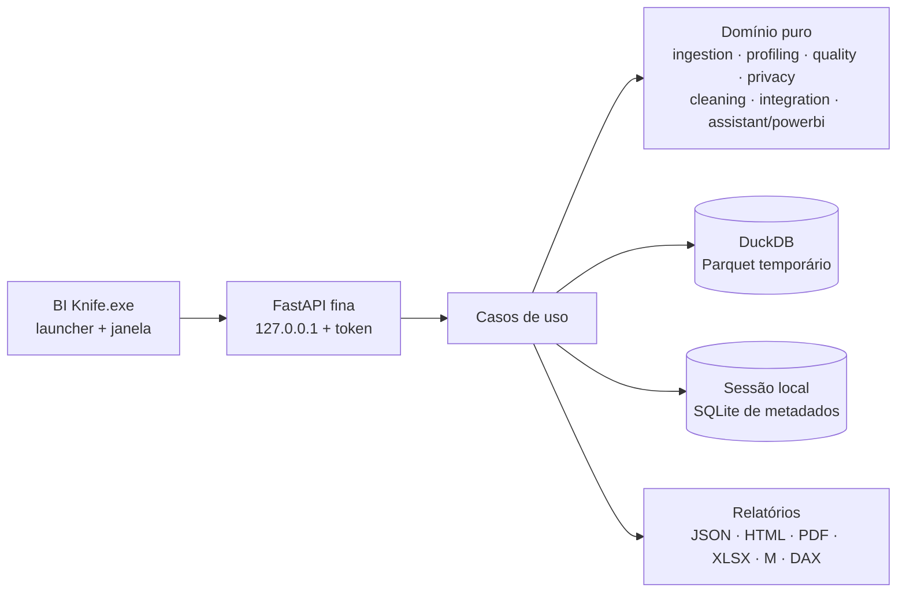

# BI KNIFE — MASTER PLAN

> Referência central do projeto. Reúne a visão do produto, a situação atual, a arquitetura-alvo, as decisões e os próximos passos.
> Versão 1.0 · 08/11/2026 · Base auditada: commit `9813e2f` (BI Swiss Knife v3.0.0)
> **Status: aguardando aprovação do dono do produto. Nenhum código foi alterado.**

---

## 1. Visão em uma frase

**O BI Knife diagnostica, explica e prepara arquivos Excel e CSV para o Power BI, 100% no computador do usuário, e entrega o roteiro de correção pronto em Power Query.**

Público principal: analistas de BI e de negócio que vivem no Power BI e no Excel (não programadores).
Diferencial: diagnóstico do **modelo inteiro** + explicação de **impacto** + **script M gerado** + privacidade **comprovável** + Brasil nativo.
Detalhes: [`docs/02_PRD.md`](docs/02_PRD.md)

---

## 2. Onde estamos (diagnóstico resumido)

**Base sólida:** ~7.800 linhas; FastAPI + pandas + openpyxl; **131 testes passando**; validação de planilhas acima da média; privacidade testada (sem rede, logs limpos, original intacto); heurísticas explicáveis.

**Defeitos confirmados por execução:**

| ID | Defeito | Gravidade |
|---|---|---|
| D1 | Datas ISO (`2024-01-10`) viram 1º de outubro: dia e mês trocados | 🔴 |
| D2 | Salário, nome e dados bancários **não** são protegidos, apesar de o SECURITY.md prometer | 🔴 |
| D3 | Códigos `P12`/`AB-1001` classificados como número | 🟠 |
| D4 | `R$ 1.234` vira 1,234; `1.234.567` vira inválido | 🟠 |
| D5 | CSV grande: perfila só as primeiras 25 mil linhas (2,5% de 1 milhão), com viés, e o relatório diz que não houve amostragem | 🟠 |
| D6 | A análise trava o servidor durante a execução (endpoints síncronos) | 🟡 |

**Lacunas:** limpeza e transformação não existem (o produto é somente leitura); não há prévia de dados; não há saída para Power BI (M/DAX); o README não ensina a rodar; não há CI, lint, empacotamento nem histórico.
**Arquitetura:** pastas bem separadas, mas a função central `analyze_file` tem ~300 linhas e há lógica duplicada em vários pontos.
Detalhes: [`docs/01_DIAGNOSTICO_TECNICO.md`](docs/01_DIAGNOSTICO_TECNICO.md)

---

## 3. Decisões importantes (para aprovar)

| # | Decisão | Por quê | Alternativa rejeitada |
|---|---|---|---|
| 1 | **Corrigir antes de construir** (Fase 0.5) | Diagnóstico errado destrói a confiança, que é o produto | Começar pelas funcionalidades novas |
| 2 | **Reorganizar incrementalmente, não reescrever** | Preserva 131 testes e heurísticas maduras | Reescrita total |
| 3 | **Limpeza = correções sugeridas que viram script M + arquivo limpo** | Complementa o Power Query em vez de competir com ele | Editor de transformação completo (M5) |
| 4 | **DuckDB como engine** de perfil e transformação | 100% das linhas, out-of-core, operação → SQL | Polars (2ª opção); manter o pandas |
| 5 | **UI web local + PyInstaller + pywebview** | Uma só linguagem; aproveita o frontend atual | Electron, Tauri, Qt, Streamlit |
| 6 | **Prévia de dados só na tela, opt-in, mascarada; nunca no relatório** | Viabiliza a limpeza sem perder a garantia de privacidade | Manter "nenhuma célula visível" |
| 7 | **Sem IA no MVP** | Estatística resolve; IA em nuvem viola a premissa | LLM na nuvem |
| 8 | **Gerar M/DAX, não `.pbix`** | Formato aberto, estável, auditável | Escrever PBIX |
| 9 | **API local com porta aleatória + token + verificação de Host** | Fecha CSRF/DNS rebinding | Sem proteção (atual) |
| 10 | **Política de sensíveis em 3 níveis**, com override do usuário | Cumpre o SECURITY.md e a LGPD na prática | Lista curta atual |

Arquitetura completa e ADRs: [`docs/03_ARQUITETURA.md`](docs/03_ARQUITETURA.md)

---

## 4. Arquitetura-alvo (resumo)

Conceito central novo: **Sessão + Pipeline de Operações**. Cada correção aceita vira uma operação declarativa que gera, ao mesmo tempo, o dado corrigido, o script M e o log. O original nunca é tocado.

---

## 5. Escopo do MVP 1.0

**Dentro:** importação BR correta · perfil de 100% · 6 dimensões de qualidade com catálogo de regras · política de sensíveis · prévia mascarada · 9 correções sugeridas → arquivo limpo + script M · relacionamentos CSV/XLSX + modelo estrela · DAX básico + Calendário · checklist "vai quebrar seu dashboard" · relatórios JSON/HTML/PDF/XLSX · instalador Windows.

**Fora (por ora):** merge/append/agrupamento · fuzzy matching · regras personalizadas com editor · IA · conectores de banco · PBIX · macOS.

Especificação por módulo: [`docs/04_ESPECIFICACAO_FUNCIONAL.md`](docs/04_ESPECIFICACAO_FUNCIONAL.md) · Requisitos: [`docs/05_REQUISITOS.md`](docs/05_REQUISITOS.md)

---

## 6. Roadmap por versões (SemVer, ≈10 h/semana)

| Versão | Tema | Duração | Marco |
|---|---|---|---|
| **3.0.1** | Correções críticas D1–D6, README, Host check | 2–3 sem. | Diagnóstico confiável |
| 3.1.0 | Fundação: CI, lint, camadas, decompor `analyze_file` | 5–6 sem. | JSON idêntico ao da 3.0.1, código limpo |
| 3.2.0 | Catálogo de regras, `Issue`, veredito, sensíveis em 3 níveis | 4 sem. | Canário verde |
| 3.3.0 | Engine DuckDB, sessão, prévia mascarada | 6 sem. | 1 milhão de linhas a 100% em < 20 s |
| 3.4.0 | Nova interface (etapas + "Entender") | 4 sem. | Teste com usuários |
| **4.0.0** | Correções sugeridas + script M + arquivo limpo | 8 sem. | Equivalência DuckDB × Power BI |
| 4.1.0 | Assistente Power BI | 5 sem. | — |
| 4.2.0 | Relatórios XLSX e histórico | 3 sem. | — |
| **4.3.0** | Instalador Windows | 4 sem. | **MVP concluído (~8 meses)** |

Roadmap detalhado com as práticas de engenharia de cada versão: [`docs/08_ROADMAP.md`](docs/08_ROADMAP.md) · Backlog: [`docs/09_BACKLOG.md`](docs/09_BACKLOG.md)

---|---|---|---|
| 0 ✅ | Diagnóstico e documentação | — | Este documento |
| **0.5** | **Corrigir D1–D5, README, Host check** | 3 sem. | v3.0.1 |
| 1 | Fundação: estrutura, CI, lint, logs, decompor `analyze_file` | 6 sem. | CI verde, sem função > 80 linhas |
| 2 | Novo núcleo: DuckDB, sessão, prévia, regras de qualidade, tela "Entender" | 6 sem. | 1 milhão de linhas a 100% em < 20 s |
| 3 | Correções sugeridas + script M + arquivo limpo | 8 sem. | Equivalência DuckDB × Power BI |
| 4a | Assistente Power BI (estrela, DAX, checklist) | 5 sem. | — |
| 5 | Relatórios e histórico | 3 sem. | Canário em todos os formatos |
| 6 | Instalador e documentação do usuário | 4 sem. | **MVP 1.0 (~8 meses)** |
| 4b | Inteligência ampliada, fuzzy | pós-MVP | — |

Roadmap detalhado: [`docs/08_ROADMAP.md`](docs/08_ROADMAP.md) · Backlog (50 itens, ≈ 400 h + margem): [`docs/09_BACKLOG.md`](docs/09_BACKLOG.md)

---

## 7. Recomendação objetiva: o que fazer primeiro

1. **BK-001 a BK-006: corrigir os 5 defeitos de cálculo e privacidade, cada um com um teste que falha antes.** São ~25 h. Depois disso, tudo o que o BI Knife diz passa a ser verdade.
2. **BK-007: README "como rodar"** (1 h) e adotar o padrão de commits do doc 13.
3. **Validar a tese antes da Fase 3:** escrever à mão o script M para 3 problemas reais e mostrar a 3 analistas de BI. Esse experimento decide se o diferencial principal vale os ~8 meses.
4. Só então começar a Fase 1.

---

## 8. Índice da documentação

| Documento | Conteúdo | Nome pedido no briefing |
|---|---|---|
| [`docs/01_DIAGNOSTICO_TECNICO.md`](docs/01_DIAGNOSTICO_TECNICO.md) | Auditoria completa, classificação de funcionalidades, defeitos | (diagnóstico) |
| [`docs/02_PRD.md`](docs/02_PRD.md) | Definição do produto | PRD.md |
| [`docs/03_ARQUITETURA.md`](docs/03_ARQUITETURA.md) | Atual × alvo, ADRs, diretórios, fluxos, tecnologias | ARCHITECTURE.md |
| [`docs/04_ESPECIFICACAO_FUNCIONAL.md`](docs/04_ESPECIFICACAO_FUNCIONAL.md) | Os 9 módulos com 12 itens cada | FUNCTIONAL_SPECIFICATION.md |
| [`docs/05_REQUISITOS.md`](docs/05_REQUISITOS.md) | RF e RNF com prioridade e status | REQUIREMENTS.md |
| [`docs/06_UX_INTERFACE.md`](docs/06_UX_INTERFACE.md) | Avaliação e proposta de telas | (UX) |
| [`docs/07_SEGURANCA.md`](docs/07_SEGURANCA.md) | Estratégia, ameaças, verificação das premissas | SECURITY.md (estratégia) |
| [`docs/08_ROADMAP.md`](docs/08_ROADMAP.md) | Fases 0 a 6 | ROADMAP.md |
| [`docs/09_BACKLOG.md`](docs/09_BACKLOG.md) | 50 itens priorizados | (backlog) |
| [`docs/10_DATA_QUALITY_RULES.md`](docs/10_DATA_QUALITY_RULES.md) | Catálogo de regras | DATA_QUALITY_RULES.md |
| [`docs/11_TESTING_STRATEGY.md`](docs/11_TESTING_STRATEGY.md) | Pirâmide, conjunto-ouro, canário | TESTING_STRATEGY.md |
| [`docs/12_DEPLOYMENT.md`](docs/12_DEPLOYMENT.md) | Como rodar hoje, empacotamento, release | DEPLOYMENT.md |
| [`docs/13_CONTRIBUTING.md`](docs/13_CONTRIBUTING.md) | Fluxo, commits, Definition of Done | CONTRIBUTING.md |
| [`docs/14_AVALIACAO_ESTRATEGICA.md`](docs/14_AVALIACAO_ESTRATEGICA.md) | As 10 perguntas estratégicas | (avaliação) |

**Sobre os nomes dos arquivos:** usei prefixos numéricos em vez dos nomes em maiúsculas do briefing por dois motivos. (1) `docs/ARCHITECTURE.md` e `docs/ROADMAP.md` **colidiriam no Windows** com os arquivos existentes `docs/architecture.md` e `docs/roadmap.md`, porque o sistema de arquivos não diferencia maiúsculas de minúsculas. (2) A numeração dá a ordem de leitura. Nenhum arquivo existente foi alterado ou apagado.

**Pendente de autorização (não alterei):** `README.md` (falta a seção "Como executar"; o texto pronto está no doc 12), `SECURITY.md` (alinhar com o comportamento real; ver doc 07, seção 6), `CHANGELOG.md` e os antigos `docs/architecture.md`/`docs/roadmap.md` (marcar como históricos).
