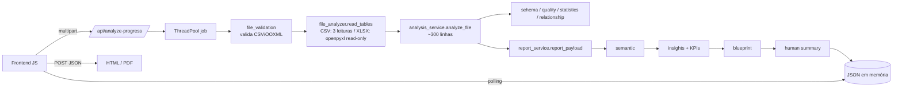

# 01 — Diagnóstico técnico do BI Knife (estado atual)

> Auditoria realizada em 08/11/2026 sobre o commit `9813e2f` (branch `master`) de `frncisc0/Projeto_BI_Knife`.
> Nenhum arquivo de código foi alterado. Tudo o que aparece como **FATO** foi verificado no código **e/ou executado**.
> O que aparece como **RECOMENDAÇÃO** é proposta e depende de aprovação.

---

## 1. Resumo executivo

O BI Knife (nome interno no código: *BI Swiss Knife*, versão `3.0.0`) é hoje um **analisador de dados local, somente leitura**, com uma camada heurística de "assistente de BI". A base é mais sólida do que o histórico de commits sugere: validação de arquivos cuidadosa, preocupação real com privacidade, **131 testes automatizados passando** e contratos de dados com Pydantic.

Ao mesmo tempo, a auditoria encontrou **seis defeitos confirmados por execução**. Dois deles afetam diretamente a credibilidade do produto: **datas trocadas** e **estatísticas de salário expostas, apesar de a documentação prometer o contrário**. Há também dívidas de arquitetura que vão travar a evolução se não forem tratadas antes de novos módulos.

| Dimensão | Avaliação | Comentário curto |
|---|---|---|
| Importação e validação | 🟢 Boa | Validação OOXML acima da média para um projeto deste porte |
| Profiling e qualidade | 🟡 Funcional com defeitos | Inferência de tipos e amostragem com erros que distorcem o resultado |
| Privacidade | 🟡 Boa intenção, cobertura incompleta | Detecção de sensíveis menor que a documentada |
| Assistente de BI (insights, blueprint) | 🟡 Funcional e heurístico | Útil, mas sem saída acionável para Power BI |
| Limpeza e transformação | 🔴 Não existe | O produto é 100% somente leitura hoje |
| Arquitetura | 🟡 Modular nas pastas, monolítica nas funções | Função principal com ~300 linhas; lógica duplicada |
| Testes | 🟢 Bons em volume | 131 testes; nenhum pegou os defeitos encontrados |
| Distribuição | 🔴 Não existe | Sem instruções de execução no README, sem empacotamento, sem CI |

---

## 2. Inventário do projeto (FATO)

### 2.1 Tamanho e composição

- **~7.800 linhas** versionadas (sem dados de teste): ~4.900 em Python, ~620 em JavaScript, ~1.900 em testes e docs.
- **Backend:** FastAPI + Uvicorn. **Frontend:** HTML, CSS e JavaScript puro (um único `app.js` com 616 linhas), servido pelo próprio FastAPI.
- **Dependências** (`requirements.txt`): `fastapi`, `uvicorn[standard]`, `python-multipart`, `pandas`, `openpyxl`, `pydantic`, `reportlab`, `pytest`. São enxutas e não há dependência desnecessária. Ressalva: `pytest` está misturado com as dependências de execução.
- **Banco de dados:** nenhum. Não existe persistência; os resultados vivem em memória.
- **IA:** nenhuma. Existe só um contrato `AIProvider` com a implementação `NoAIProvider` (desligada), o que é uma decisão correta.

### 2.2 Estrutura de diretórios

```text
app/
├── main.py                 # cria o FastAPI, monta /static, logging básico
├── api/routes.py           # 7 endpoints (344 linhas)
├── core/                   # config.py (limites via variáveis de ambiente), exceptions.py
├── security/               # file_validation.py (validação CSV/OOXML)
├── analyzers/              # file, schema, quality, statistics, relationship
├── services/               # analysis_service (orquestração), report, html/pdf, progress, human summary
├── semantic/               # modelo semântico (dimensões/medidas)
├── structure/              # perfis estruturais / hipóteses de grão
├── insights/               # engine de insights, KPIs, scoring
├── blueprint/              # proposta de dashboard
├── models/                 # contratos Pydantic (21 classes)
└── ai/                     # NoAIProvider
frontend/                   # index.html, css, js/app.js, js/report_names.js
tests/                      # unit (91), integration (28), security (12), frontend (node)
docs/                       # architecture.md, roadmap.md, xlsx-ingestion.md
test-data/                  # CSV/XLSX fictícios
```

### 2.3 Endpoints (FATO)

| Método | Rota | Função | Observação |
|---|---|---|---|
| GET | `/` | Serve `index.html` | — |
| GET | `/api/health` | Health check | Retorna `privacy: local-only` |
| POST | `/api/analyze` | Analisa 1 arquivo | `async`, mas executa pandas de forma síncrona (ver D6) |
| POST | `/api/analyze-batch` | Analisa até 50 arquivos | Mesmo problema de bloqueio |
| POST | `/api/analyze-progress` | Inicia um job em segundo plano | Thread pool com 2 workers; **é o que o frontend usa** |
| GET | `/api/analyze-jobs/{id}/progress` | Polling de progresso e resultado | Jobs guardados em memória (máx. ~20) |
| POST | `/api/report-html` | Gera HTML offline a partir do JSON | Tamanho limitado |
| POST | `/api/report-pdf` | Gera PDF (ReportLab) | Tamanho limitado |

### 2.4 Fluxo real de processamento



---

## 3. Classificação das funcionalidades

Legenda: **1** Implementada e funcional · **2** Parcial · **3** Existe com problemas · **4** Planejada, não implementada · **5** Não existe

### Importação
| Funcionalidade | Status | Evidência |
|---|---|---|
| CSV | **1** | Testado com 1.000.000 de linhas / 53 MB: concluiu em ~7,9 s |
| XLSX / XLSM (sem executar macros) | **1** | `openpyxl` com `read_only`, `data_only`, `keep_vba=False`, `keep_links=False` |
| Múltiplas abas | **1** | `sample.xlsx` → abas `Clientes` e `Pedidos` analisadas |
| Múltiplos arquivos e pastas | **1** | Lote de até 50 arquivos; o frontend aceita pasta |
| Detecção de codificação | **3** | O fallback `latin-1` sempre decodifica, então o erro de codificação nunca é disparado e há risco de caracteres corrompidos sem aviso |
| Detecção de delimitador | **1** | `csv.Sniffer` + contagem; o usuário pode sobrescrever |
| Detecção de cabeçalho | **1** | Heurística + diálogo de confirmação quando ambíguo (bom design) |
| Pré-visualização dos dados | **5** | **Decisão deliberada de privacidade:** o relatório nunca publica células. Conflita com o pedido de "pré-visualização" e exige decisão de produto |
| Detecção de tipos | **3** | Defeitos D1, D3 e D4 abaixo |

### Profiling e qualidade
| Funcionalidade | Status | Evidência |
|---|---|---|
| Linhas, colunas, nulos, únicos, cardinalidade | **1** | — |
| Duplicidades de linha | **1** | Calculada sobre a **amostra** |
| Estatísticas descritivas (min, max, média, quartis, desvio) | **3** | Corretas para números, mas datas erradas (D1) e salário exposto (D2) |
| Amostragem | **3** | CSV usa as **primeiras** N linhas, não uma amostra aleatória (D5) |
| Score de qualidade (5 dimensões ponderadas) | **1** | Completude, unicidade, consistência, validade e integridade |
| Integridade referencial | **2** | Só é calculada quando há candidatos a relacionamento |
| Padronização (ex.: "SP" vs "São Paulo") | **5** | — |
| Anomalias (IQR) | **1** | Conservador e explicado |
| Limites (linhas, colunas, células, tempo, tamanho) | **2** | O timeout é verificado entre etapas e não interrompe uma operação em andamento (está documentado) |

### Limpeza, transformação e integração
| Funcionalidade | Status |
|---|---|
| Qualquer limpeza (duplicados, nulos, textos, datas, CPF/CNPJ) | **5** |
| Qualquer transformação (renomear, tipos, merge, append, colunas calculadas) | **5** |
| Detecção de chaves simples e compostas | **1** |
| Relacionamentos entre abas (mesmo XLSX) | **1** |
| Relacionamentos entre arquivos | **2** | Só entre **CSVs**; XLSX fica de fora no cruzamento entre arquivos |
| Correspondência aproximada (fuzzy) e detecção de conflitos | **5** |

### Assistente de BI e relatórios
| Funcionalidade | Status |
|---|---|
| Modelo semântico (dimensão/medida/data) | **1** (heurístico) |
| Sugestão de KPIs, perguntas e visuais | **1** (heurístico, determinístico e explicado) |
| Blueprint de dashboard (páginas, filtros) | **1** |
| Classificação fato/dimensão | **2** | Baseada principalmente no **nome da aba** |
| Saída acionável para Power BI (M, DAX, modelo) | **5** |
| Exportação JSON, HTML e PDF | **1** |
| Exportação CSV (resumo) | **1** (gerada no frontend) |
| Exportação Excel | **5** |
| Histórico de processamento | **5** |

### Engenharia
| Item | Status | Comentário |
|---|---|---|
| Testes automatizados | **1** | 131 passando em ~15 s (91 unit, 28 integration, 12 security) + teste de frontend em Node |
| Testes de privacidade (sem rede, sem vazamento em logs) | **1** | Ponto forte do projeto |
| Logs | **2** | `logging.basicConfig` só no console; sem arquivo, rotação ou nível configurável |
| Tratamento de erros | **1** | Exceções de domínio → HTTP 400/422; erros inesperados expõem só o tipo |
| Instruções de execução | **5** | **O README não explica como instalar nem rodar** |
| Empacotamento para Windows | **5** | — |
| CI (GitHub Actions) | **5** | — |
| Lint e formatação configurados | **5** | Sem `pyproject.toml` |

---

## 4. Defeitos confirmados (com reprodução)

### D1 — Datas ISO têm dia e mês trocados 🔴 P0
- **Onde:** `statistics_analyzer.py`, `quality_analyzer.py` e `schema_analyzer.py` usam `pd.to_datetime(..., format="mixed", dayfirst=True)`.
- **Reprodução:** `['2024-01-10','2023-05-02']` → `2024-10-01` e `2023-02-05`.
- **Impacto:** a data máxima aparece errada no relatório (teste real: `data_admissao` máx. = 2024-10-01 em vez de 2024-01-10). Distribuição mensal, "lacunas" e sugestões de tendência ficam distorcidas. É um erro silencioso, e isso é o pior tipo para uma ferramenta de diagnóstico.
- **Correção:** detectar o formato antes de converter (ISO → `dayfirst=False`; `dd/mm/aaaa` → `dayfirst=True`) e registrar o formato detectado no relatório.

### D2 — Dados sensíveis menos protegidos do que o SECURITY.md promete 🔴 P0
- **Promessa (SECURITY.md):** estatísticas são suprimidas quando o nome sugere *"CPF/CNPJ, e-mail, telefone, nome, salário ou dados bancários"*.
- **Código:** `SENSITIVE_NAME_CATEGORIES` cobre só `cpf`, `cnpj`, `telefone`, `email`, `rg` e `documento`.
- **Reprodução:** um CSV com a coluna `salario` retorna `min=3100, max=9100, mean=6137,56` no JSON e na aba "Estatísticas" da interface. As colunas `nome` e `conta_bancaria` também não são marcadas como sensíveis.
- **Impacto:** a promessa de privacidade, que é o principal diferencial do produto, não é cumprida. Em ambiente corporativo (RH, folha de pagamento), isso desqualifica o produto.
- **Correção:** alinhar código e documentação, ampliar o dicionário (salário, remuneração, nome, conta, agência, PIX, endereço, nascimento, matrícula) e adicionar testes que leiam o SECURITY.md como especificação.

### D3 — Códigos alfanuméricos classificados como números 🟠 P1
- **Onde:** `numeric_values()` remove tudo o que não é dígito antes de converter.
- **Reprodução:** `['P12','P900']` e `['AB-1001','XY-77']` → `numérico (texto)`.
- **Impacto:** códigos de produto e SKU recebem estatísticas numéricas sem sentido, podem virar "medida" no modelo semântico e geram KPIs absurdos, como "soma de produto".

### D4 — Separador de milhar brasileiro mal interpretado 🟠 P1
- **Reprodução:** `"R$ 1.234"` → `1.234`; `"1.234.567"` → `NaN`.
- **Impacto:** valores monetários brasileiros sem centavos ficam 1.000 vezes menores ou viram "inválidos" e derrubam o score de validade. Para uma ferramenta em português, esse é o caso mais comum.

### D5 — A amostragem de CSV pega o início do arquivo e é rotulada como "none" 🟠 P1
- **Reprodução:** CSV de 1.000.000 de linhas → `rows_analyzed=25000`, `sampled=true`, `sampling_method="none"`.
- **Impacto:** (a) só 2,5% do arquivo é perfilado, e de forma **enviesada**: arquivos ordenados por data mostram só o período inicial; (b) o rótulo contradiz o próprio relatório. O XLSX usa *reservoir sampling* (correto), então os dois formatos se comportam de forma inconsistente.
- **Causa:** `_row_limit` limita a `max_cells_to_analyze (250.000) / colunas`, e o CSV é lido com `nrows`.

### D6 — Análise bloqueia o servidor 🟡 P2
- **Reprodução:** durante a análise do CSV de 53 MB via `/api/analyze`, uma chamada a `/api/health` levou **4,9 s** (contra 0,01 s normalmente).
- **Causa:** endpoints `async def` executam pandas de forma síncrona no event loop. O fluxo `/analyze-progress`, que o frontend usa, roda em thread e não sofre disso, mas `/analyze` e `/analyze-batch` sim.

### D7 — Datas `dd/mm/aaaa` classificadas como número 🔴 P0 *(encontrado durante a correção, na v3.0.1)*
- **Reprodução:** `10/01/2024` → `numeric_values` removia a `/` e gerava `10012024`, então a coluna virava "numérico (texto)", com média e desvio sem sentido.
- **Impacto:** toda coluna de data no padrão do Excel brasileiro deixava de ser data.
- **Status:** corrigido na v3.0.1, junto com o D3 (validação estrita do formato numérico).

> **Status em 08/11/2026:** D1 a D7 corrigidos na branch `release/v3.0.1`, com testes de regressão em `tests/unit/test_v301_regressions.py` (157 testes passando).

### Outros achados (menor gravidade)
- **Limiares de nulos iguais:** `null_moderate_threshold_pct = null_critical_threshold_pct = 20`, o que deixa a lógica de faixas confusa.
- **`Settings` lê variáveis de ambiente na carga do módulo** (atributos de classe) e é cacheado com `lru_cache`, então é difícil configurar e testar.
- **O CSV é lido 4 vezes:** validação completa, cabeçalho, contagem em blocos e amostra. Funciona, mas multiplica o custo em arquivos grandes.
- **Memória:** o upload inteiro fica em `bytes`, a validação decodifica o texto inteiro, e o job com progresso mantém **todos os arquivos do lote** (até 500 MB) em memória ao mesmo tempo.
- **Exposição local:** não há verificação de `Host`/`Origin`. Rodando em `127.0.0.1`, o risco é baixo, mas *DNS rebinding* permitiria a uma página maliciosa ler respostas. Mitigação simples: `TrustedHostMiddleware`.

---

## 5. Problemas arquiteturais

| # | Problema | Evidência | Por que dificulta a evolução |
|---|---|---|---|
| A1 | **Função "deus"** | `analyze_file()` tem ~300 linhas e mistura leitura, perfil, chaves, qualidade, relacionamentos, configurações e segurança | Cada novo módulo vai mexer nessa função, com risco alto de regressão |
| A2 | **Duplicação** | `_cardinality` definida 2× no mesmo arquivo; `_norm` 4×; validação de opções CSV, limites e leitura de upload repetidas em 3 endpoints; score de qualidade recalculado em `routes.py` | Corrigir num lugar e esquecer o outro |
| A3 | **Payload como `dict` solto** | `report_payload` e `refresh_discovery_payload` mutam dicionários depois da análise | Os contratos Pydantic existem, mas são abandonados no meio do fluxo |
| A4 | **Somente leitura por construção** | Não existe representação de "dataset em memória" que possa ser alterado; tudo vira relatório | Limpeza e transformação exigem um novo núcleo (sessão + pipeline de operações) |
| A5 | **Estado em memória** | Jobs em `dict` global; resultado se perde ao reiniciar | Sem histórico, sem "abrir análise anterior" |
| A6 | **Frontend monolítico** | `app.js` com 616 linhas de templates `innerHTML` (o escape é feito de forma consistente, o que é bom) | Funciona hoje, mas não escala para telas de transformação interativas |
| A7 | **Inconsistência CSV × XLSX** | Amostragem diferente; relacionamentos entre arquivos só para CSV | O mesmo dado gera resultados diferentes conforme o formato |

## 6. Pontos fortes que devem ser preservados

1. **Validação OOXML:** rejeição de DTD/ENTITY, limite de expansão (zip bomb), detecção de macros, ActiveX, links e conexões, sem nunca executar nada.
2. **Privacidade por design:** relatório sem valores de células, logs só com o tipo de erro, teste que garante que **não existem clientes de rede no código**, teste de que o arquivo original não é alterado.
3. **Heurísticas explicáveis:** todo insight tem "por que foi sugerido" e nível de confiança. Isso diferencia o produto de ferramentas caixa-preta.
4. **Diálogo de cabeçalho ambíguo:** o sistema pergunta em vez de chutar, o que mostra maturidade de UX.
5. **Limites configuráveis** para tudo (linhas, colunas, células, tempo, tamanho de relatório).

## 7. Por que os testes não pegaram os defeitos

Os 131 testes verificam bem **segurança e estrutura do relatório**, mas quase não testam a **correção dos valores calculados** com dados realistas brasileiros: datas ISO, milhares com ponto, códigos alfanuméricos, colunas de RH. A estratégia de testes (doc 11) propõe um **conjunto-ouro de arquivos com resultado esperado conhecido**.
