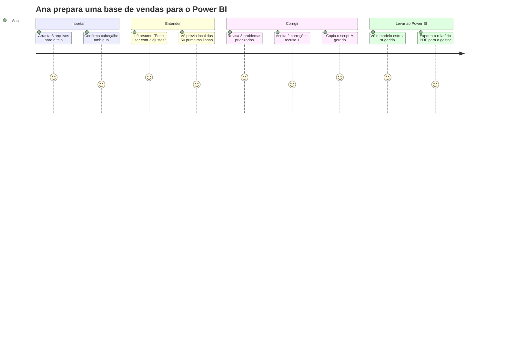

# 02 — PRD: Documento de Definição do Produto

## 1. O que é o BI Knife

O BI Knife é uma **aplicação local para Windows que diagnostica, explica e prepara arquivos Excel e CSV antes de entrarem no Power BI**. Ela responde três perguntas que todo analista faz antes de montar um dashboard:

1. **"Posso confiar nesses dados?"** → diagnóstico de qualidade explicado.
2. **"O que preciso corrigir?"** → problemas priorizados, com correção sugerida.
3. **"Como isso vira um modelo de BI?"** → tabelas fato/dimensão, chaves, relacionamentos, medidas e o **código Power Query (M) pronto** para aplicar as correções.

**Proposta de valor (uma frase):**
> *O BI Knife faz em 2 minutos, sem tirar os dados do seu computador, o diagnóstico que um analista experiente levaria 2 horas para fazer — e entrega o roteiro de correção pronto para o Power BI.*

## 2. Problema

Antes de qualquer dashboard, o analista gasta horas abrindo planilhas, procurando nulos, duplicados, datas em formatos misturados, códigos que viraram número, chaves que não batem entre tabelas. Esse trabalho:

- é **repetitivo e não documentado** (o próximo analista refaz tudo);
- é **frágil**: o problema aparece no dashboard já publicado ("o total não fecha");
- **não pode ir para ferramentas na nuvem**, porque os dados são corporativos, de RH ou financeiros (LGPD, política interna);
- é **difícil para quem está começando**: o júnior não sabe o que procurar.

## 3. Público

| Persona | Perfil | O que precisa | Prioridade |
|---|---|---|---|
| **Ana, analista de BI júnior/pleno** | Usa Power BI e Excel; conhece DAX básico e pouco Python | Saber rápido se a base está boa e o que corrigir no Power Query | **Primária** |
| **Bruno, analista de negócio** | Recebe planilhas de outras áreas e monta relatórios | Entender a base sem programar e explicar a qualidade ao gestor | Primária |
| **Carla, consultora de BI** | Recebe bases de clientes diferentes toda semana | Diagnóstico padronizado e relatório para entregar ao cliente | Secundária |
| **Diego, engenheiro de dados** | Usa Python e SQL | Perfil rápido de arquivo, mas tem alternativas (pandas, ydata-profiling) | Terciária: não desenhar o produto para ele |

> **Decisão de foco:** o produto é para quem **vive no Power BI e no Excel**, não para quem já programa. Isso orienta todas as escolhas de interface e escopo.

## 4. Diferenciais (o que já existe e o que deve ser construído)

| Diferencial | Estado | Por que importa |
|---|---|---|
| **100% local, comprovável** (teste automatizado de ausência de rede) | ✅ Existe | Permite o uso com dados de RH e financeiros, o que ferramentas web não oferecem |
| **Explica em linguagem simples** e mostra "por que" de cada achado | ✅ Existe | Ensina o usuário júnior; profilers comuns só despejam números |
| **Pensado para o Brasil** (CPF/CNPJ, `dd/mm/aaaa`, `1.234,56`, cp1252) | 🟡 Parcial e com bugs | Profilers internacionais erram exatamente aqui |
| **Saída acionável para Power BI** (script M, sugestão de modelo estrela, DAX das medidas) | 🔴 Não existe | **Este é o diferencial que justifica o produto.** Sem ele, o BI Knife é "mais um profiler" |
| **Seguro com planilhas suspeitas** (macros e links nunca executados) | ✅ Existe | Importante em ambiente corporativo |

## 5. Objetivos e métricas

| Objetivo | Métrica de sucesso (MVP) |
|---|---|
| Diagnóstico confiável | 0 erros de cálculo no conjunto-ouro de testes (datas, números BR, códigos) |
| Rapidez | Arquivo de 1 milhão de linhas diagnosticado em < 30 s, com perfil de **todas** as linhas |
| Utilidade para Power BI | ≥ 80% dos problemas encontrados vêm com correção em M aplicável sem edição |
| Privacidade | Teste automatizado de "nenhuma conexão de rede" e "nenhum valor sensível no relatório" sempre verde |
| Facilidade | Usuário sem Python instala e roda em < 5 minutos (instalador `.exe`) |

## 6. Escopo

### Dentro do escopo (MVP)
- Importar CSV, XLSX e XLSM (várias abas, vários arquivos).
- Diagnóstico de estrutura, tipos, qualidade e sensibilidade.
- **Pré-visualização local opcional** na tela (nunca no relatório), com colunas sensíveis mascaradas. Isso resolve o conflito com a decisão atual de "nenhuma célula visível" (ver ADR-04 em `03_ARQUITETURA.md`).
- Relacionamentos e chaves entre abas e arquivos (CSV **e** XLSX).
- **Plano de correção:** lista de problemas → correção sugerida → **script Power Query (M) gerado**.
- **Exportação da base corrigida** (CSV/XLSX) com log de transformações, preservando sempre o original.
- Relatório de qualidade em HTML, PDF e JSON.
- Instalador Windows.

### Fora do escopo (agora)
- Conectar a bancos de dados, APIs ou SharePoint (fase futura, se houver demanda comprovada).
- Gerar arquivos `.pbix`/`.pbit` (formato fechado e frágil; o M e o DAX gerados cobrem 80% do valor).
- Editor de transformação visual completo, que concorreria com o próprio Power Query (ver doc 14, seção 2).
- IA externa ou envio de dados para fora do computador.
- Multiusuário, servidor, login.
- macOS e Linux como alvo oficial (o código é portável, mas o teste e o instalador são só para Windows).

## 7. Funcionalidades (visão de produto)

| Módulo | Entra no MVP? | Observação |
|---|---|---|
| M1 Data Import | ✅ | Corrigir tipos e amostragem; adicionar prévia local |
| M2 Data Profiling | ✅ | Perfil completo via motor colunar (ver arquitetura) |
| M3 Data Quality | ✅ | Regras documentadas em `10_DATA_QUALITY_RULES.md` |
| M4 Data Cleaning | 🟡 **Recorte** | Só correções **sugeridas e reversíveis**: tipos, datas, números BR, trim, duplicados exatos, CPF/CNPJ. Gera M + arquivo limpo |
| M5 Data Transformation | ❌ Adiado | Renomear e alterar tipo entram via M4; merge/append/agrupamento ficam para depois |
| M6 Data Intelligence | 🟡 Manter o atual | IQR e tendência mensal já existem; nada de IA |
| M7 Data Integration | 🟡 Recorte | Chaves e relacionamentos com cobertura; fuzzy matching adiado |
| M8 BI Assistant | ✅ **Foco** | Modelo estrela sugerido, medidas DAX básicas, avisos de "isso vai quebrar seu dashboard" |
| M9 Reports & Export | ✅ | + exportação Excel do relatório e log de transformações |

## 8. Experiência de uso (jornada principal)

Princípios de experiência:
1. **Primeiro a resposta, depois o detalhe:** "Pode usar? Sim, com 3 ajustes" antes de qualquer tabela.
2. **Nada é alterado sem o usuário ver e aceitar.**
3. **Toda conclusão mostra a evidência e o nível de confiança.**
4. **Linguagem de analista, não de programador:** "coluna de código" em vez de "dtype object".
