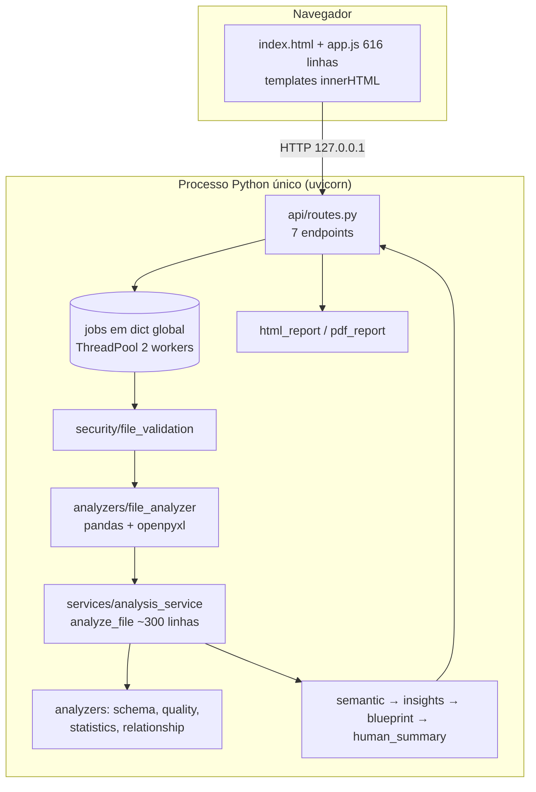
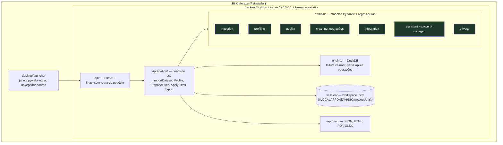
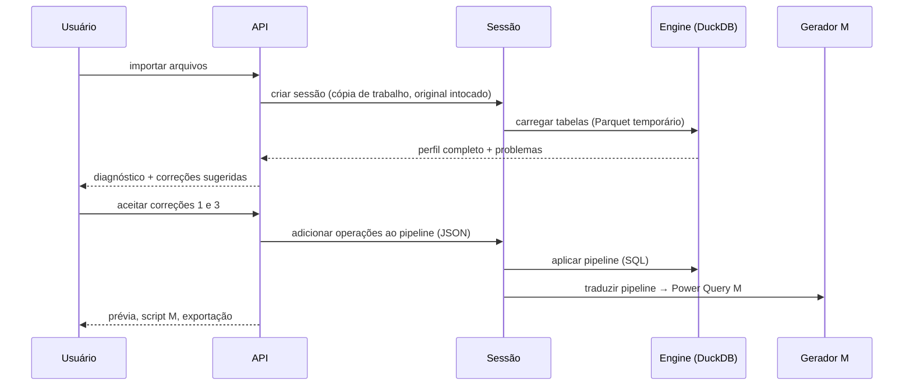

# 03 — Arquitetura: atual e recomendada

> Este documento complementa o `docs/architecture.md` existente, sem substituí-lo. O antigo descreve a V3.0 como ela é; este define para onde ir.

## 1. Arquitetura atual (FATO)



**Característica central:** é um *pipeline* linear e **somente leitura**. Arquivo entra, relatório sai. Não existe o conceito de "dataset aberto" que o usuário possa examinar e alterar.

## 2. Decisão: reorganizar, não reescrever

**Recomendação: refatoração incremental, sem reescrita.** O código existente tem valor real (validação, heurísticas, 131 testes). Reescrever jogaria isso fora e reintroduziria bugs já resolvidos.

A reorganização é necessária por três motivos concretos:
1. **Limpeza e transformação exigem um núcleo novo** (sessão + operações), que não cabe no pipeline atual.
2. **`analyze_file` precisa ser quebrada** antes de receber mais responsabilidades (A1 do diagnóstico).
3. **O perfil precisa cobrir 100% das linhas**, e o pandas com engine Python não faz isso com eficiência (D5).

Estratégia: **padrão *strangler*.** Cada módulo novo nasce na estrutura nova; os antigos migram um por vez, sempre com os testes verdes.

## 3. Arquitetura recomendada



### 3.1 Conceito novo: Sessão e Pipeline de Operações



- **Operação** = objeto declarativo e serializável, por exemplo `{"op": "parse_date", "column": "data", "format": "%Y-%m-%d"}`.
- O **mesmo pipeline** gera 3 coisas: o dado corrigido (via DuckDB), o **script M** equivalente e o **log de transformações** para o relatório.
- Desfazer = remover a operação e reaplicar. O original **nunca** é aberto para escrita.

## 4. Justificativa das decisões (ADRs resumidos)

| ADR | Decisão | Alternativas consideradas | Justificativa |
|---|---|---|---|
| **01** | **Manter Python + FastAPI** | Flask; chamar Python direto por IPC | Já funciona; validação Pydantic; OpenAPI útil para testes. Não há ganho em trocar |
| **02** | **Manter a UI web local + empacotar com PyInstaller**, com janela via `pywebview` (fallback: navegador padrão) | Electron, Tauri, PySide/Qt, Streamlit | Electron e Tauri exigem uma segunda toolchain (Node/Rust) e dobram a manutenção para um desenvolvedor solo. Qt obrigaria a reescrever a UI. Streamlit não tem controle de estado e de layout para um produto. `pywebview` usa o WebView2 que já vem no Windows 10/11 |
| **03** | **Adotar DuckDB como engine de perfil e transformação** (o pandas continua nas heurísticas existentes durante a migração) | Polars; pandas com pyarrow; manter pandas | DuckDB lê CSV de 1 GB em segundos, funciona *out-of-core* (não precisa caber na RAM), perfila 100% das linhas com SQL e mapeia naturalmente "operação → SQL". É uma dependência única, sem servidor, com wheel Windows. O Polars seria a 2ª opção (muito rápido, mas a tradução de operações para SQL é menos direta) |
| **04** | **Prévia de dados só na tela, opt-in, com colunas sensíveis mascaradas; nunca em relatório exportado** | Manter "nenhuma célula visível"; prévia livre | Limpeza sem ver o dado é inviável, mas a regra de "relatório sem células" é um diferencial e deve continuar |
| **05** | **Workspace local em `%LOCALAPPDATA%\BIKnife`** com SQLite para histórico (metadados) e Parquet temporário para os dados de trabalho | Tudo em memória (atual); banco servidor | Permite histórico, reabrir análise e arquivos grandes. Parquet temporário é apagado ao fechar a sessão, com retenção configurável |
| **06** | **Frontend: dividir em módulos ES agora (Fase 1); avaliar Svelte ou Vue com build Vite só na Fase 3** (telas de transformação) | React; manter um arquivo único; htmx | Não introduzir framework antes de existir interação que o justifique. Svelte e Vue têm curva menor que React e geram bundle estático servido pelo FastAPI |
| **07** | **Sem IA no MVP.** Manter `NoAIProvider`; IA local (Ollama) só como P3 opt-in, para redação de explicações | LLM na nuvem; IA para tipagem e anomalias | Tipos, qualidade, anomalias e relacionamentos se resolvem bem com regras e estatística, de forma determinística e explicável. LLM em nuvem viola a premissa de privacidade |
| **08** | **Geração de Power Query M e DAX por templates**, não geração de `.pbix` | Escrever `.pbix`/`.pbit` | O formato PBIX é fechado e muda a cada versão do Power BI; o script M é estável, auditável e colável |
| **09** | **Segurança local:** bind só em `127.0.0.1`, porta aleatória, token de sessão na URL e `TrustedHostMiddleware` | Sem proteção (atual) | Impede que outras páginas no navegador ou outros usuários da máquina usem a API (DNS rebinding, CSRF) |

## 5. Estrutura de diretórios recomendada

```text
bi_knife/
├── pyproject.toml                # deps, ruff, pytest, versão única
├── src/bi_knife/
│   ├── main.py                   # create_app()
│   ├── config.py                 # Settings (pydantic-settings), lido em runtime
│   ├── logging_config.py         # arquivo rotativo, filtro anti-PII
│   ├── api/                      # routers finos: imports, sessions, profile, fixes, export, health
│   ├── application/              # casos de uso (orquestram; sem pandas/duckdb direto)
│   ├── domain/
│   │   ├── models/               # contratos Pydantic (migrados de app/models)
│   │   ├── ingestion/            # detecção de encoding, delimitador, cabeçalho, data e número BR
│   │   ├── profiling/            # tipos, estatísticas, cardinalidade
│   │   ├── quality/              # regras (ver doc 10) + score
│   │   ├── privacy/              # detecção de sensíveis, mascaramento
│   │   ├── cleaning/             # catálogo de operações + validação
│   │   ├── integration/          # chaves, relacionamentos, cobertura
│   │   └── assistant/            # semantic, insights, blueprint, human_summary, powerbi/ (M e DAX)
│   ├── engine/                   # DuckDB: carregar, perfilar, aplicar pipeline
│   ├── security/                 # validação de arquivos (atual file_validation.py)
│   ├── session/                  # workspace, temporários, histórico (SQLite)
│   ├── reporting/                # html, pdf, xlsx, json
│   └── desktop/                  # launcher, porta, token, abertura de janela
├── frontend/                     # src/ (módulos), dist/ (build servido)
├── tests/
│   ├── golden/                   # conjunto-ouro: arquivo + resultado esperado
│   ├── unit/  integration/  security/  e2e/
├── packaging/                    # spec do PyInstaller, script do instalador (Inno Setup)
└── docs/
```

## 6. Responsabilidade de cada módulo

| Módulo | Faz | Não faz |
|---|---|---|
| `api` | Recebe HTTP, valida a forma da entrada e chama o caso de uso | Regra de negócio, pandas, DuckDB |
| `application` | Orquestra: abre sessão, chama domínio e engine, persiste | Cálculo |
| `domain/*` | Regras puras e testáveis (detectar, classificar, pontuar, gerar M) | I/O de arquivo e rede |
| `engine` | Executa SQL e leitura colunar; devolve agregados | Decidir o que é "problema" |
| `security` | Valida arquivo antes de qualquer leitura | Perfil |
| `privacy` | Decide o que é sensível e o que pode aparecer | — |
| `session` | Ciclo de vida da cópia de trabalho, temporários e histórico | — |
| `reporting` | Projeta o resultado em formatos | Recalcular |
| `desktop` | Iniciar o servidor, abrir a janela, encerrar e limpar | — |

## 7. Fluxo de funcionamento (alvo)

1. O usuário abre o `BI Knife.exe`. O launcher escolhe uma porta livre e gera um token; o servidor sobe em `127.0.0.1` e a janela abre.
2. O usuário arrasta os arquivos → `security` valida → `session` cria o workspace → `engine` converte para Parquet temporário (o original fica intocado).
3. `profiling` + `quality` + `privacy` + `integration` rodam sobre **100% dos dados** via DuckDB (com amostragem só acima de um limite alto, documentada e aleatória).
4. `assistant` gera o resumo, os problemas priorizados, as correções sugeridas e o modelo estrela.
5. O usuário aceita ou recusa correções → o pipeline de operações é atualizado → a prévia e o score são recalculados.
6. Exportação: arquivo corrigido + script M + relatório (HTML/PDF/XLSX) + log.
7. Ao fechar: os temporários são apagados; os metadados ficam no histórico (sem valores de células).

## 8. Tecnologias recomendadas

| Camada | Recomendado | Alternativa | Evitar |
|---|---|---|---|
| Linguagem | Python 3.12 | 3.11 | 3.13+ até as wheels estabilizarem |
| API | FastAPI | — | — |
| Engine | DuckDB | Polars | pandas com engine `python` para arquivos grandes |
| Excel (leitura) | openpyxl read-only (manter) | `python-calamine` (mais rápido; avaliar) | xlrd, pywin32/COM (executa o Excel) |
| Excel (escrita) | XlsxWriter | openpyxl | — |
| PDF | ReportLab (manter) | WeasyPrint | — |
| Persistência | SQLite (stdlib) | DuckDB em arquivo | Postgres e outros servidores |
| Config | pydantic-settings | — | Atributos de classe lidos na importação (atual) |
| Qualidade de código | ruff (lint + format), mypy gradual | — | — |
| Empacotamento | PyInstaller + Inno Setup | Nuitka | Electron |
| Janela | pywebview (WebView2) | Navegador padrão | — |
| CI | GitHub Actions (windows-latest) | — | — |
