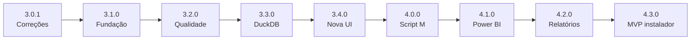

# 08 — Roadmap por versões

> Versionamento **SemVer** (`MAJOR.MINOR.PATCH`), a partir da versão atual **3.0.0**.
> **PATCH** = correção sem mudar contrato · **MINOR** = funcionalidade nova compatível · **MAJOR** = muda o contrato (JSON, fluxo ou API).
> Capacidade considerada: ~10 h por semana. O **MVP termina na v4.3.0**.

## Visão geral

| Versão | Tipo | Tema | Duração | Saída visível ao usuário |
|---|---|---|---|---|
| **3.0.1** | PATCH | Correções críticas (D1–D6) | 2–3 sem. | Diagnóstico passa a dizer a verdade |
| **3.1.0** | MINOR | Fundação de engenharia | 5–6 sem. | Logs em arquivo; nada mais muda (de propósito) |
| **3.2.0** | MINOR | Qualidade e privacidade | 4 sem. | Problemas com impacto e veredito; sensíveis em 3 níveis |
| **3.3.0** | MINOR | Engine DuckDB e sessão | 6 sem. | Perfil de 100% das linhas; prévia mascarada |
| **3.4.0** | MINOR | Nova interface | 4 sem. | Navegação por etapas; tela "Entender" |
| **4.0.0** | **MAJOR** | Correções + script Power Query | 8 sem. | Corrigir → script M → arquivo limpo |
| **4.1.0** | MINOR | Assistente Power BI | 5 sem. | Modelo estrela, DAX, Calendário, checklist |
| **4.2.0** | MINOR | Relatórios e histórico | 3 sem. | Relatório XLSX, log, sessões recentes |
| **4.3.0** | MINOR | **Instalador Windows (MVP)** | 4 sem. | `BIKnife-Setup.exe` |
| 4.4+ | MINOR | Pós-MVP | — | Fuzzy, tendências, regras personalizadas |

**Por que esta ordem:** primeiro **correção** (não se constrói sobre resultado errado), depois **estrutura** (não se adiciona funcionalidade em código que já está difícil de mudar), depois **funcionalidade** e, por último, **distribuição**.

---

## Processo de engenharia (vale para todas as versões)

| Prática | Como aplicamos | Por quê |
|---|---|---|
| **Fluxo Git** | *Trunk-based* com branches curtas: `fix/…`, `feat/…`, `refactor/…` → Pull Request → `master` | Branches longas geram conflito; PR cria histórico de decisão |
| **Conventional Commits** | `fix(profiling): …`, `feat(cleaning): …` | Histórico legível e CHANGELOG gerado a partir dele |
| **TDD para defeitos** | Teste que reproduz o bug (vermelho) → correção mínima (verde) → refatorar | Garante que o bug não volta (teste de regressão) |
| **Testes de caracterização** | Antes de refatorar, "congelar" o comportamento atual em testes | Refatorar com segurança código sem especificação |
| **Definition of Done** | Testes, CI verde, docs, CHANGELOG, sem rede, canário de privacidade | "Pronto" passa a ter um significado objetivo |
| **ADR** | Toda decisão de arquitetura registrada em `docs/adr/NNN-titulo.md` | Daqui a 6 meses você saberá *por que* escolheu algo |
| **Release** | Tag `vX.Y.Z` + GitHub Release + CHANGELOG (*Keep a Changelog*) | Versões rastreáveis e reversíveis |
| **Revisão** | Checklist de PR (mesmo sozinho: revisar o diff no dia seguinte) | Pega erros que passam despercebidos na hora de escrever |

---

## v3.0.1 — Correções críticas (PATCH)

**Objetivo:** o produto atual passa a dizer a verdade, sem mudar o contrato do JSON.

| Item | Conceito aplicado |
|---|---|
| D1 Datas ISO com dia/mês trocados | TDD + teste de regressão |
| D2 Sensíveis (salário, nome, dados bancários, nascimento) | Especificação executável: o SECURITY.md vira teste |
| D3 Códigos alfanuméricos tratados como número | TDD |
| D4 Milhar brasileiro | TDD |
| D5 Amostragem CSV enviesada e mal rotulada | TDD + consistência entre CSV e XLSX (mesmo algoritmo) |
| D6 Servidor travado durante a análise | Separar I/O assíncrono de CPU (threadpool) |
| README "Como executar", `TrustedHostMiddleware`, `requirements-dev.txt` | Documentação como parte do produto; segurança por padrão |

**Critério de saída:** testes novos falhavam antes e passam depois; os 131 testes antigos continuam verdes; tag `v3.0.1`.

## v3.1.0 — Fundação (MINOR)

**Objetivo:** deixar o código fácil e seguro de mudar. É a versão "invisível", e é a mais importante para as próximas.

| Item | Conceito aplicado |
|---|---|
| `pyproject.toml`, ruff, lockfile com hashes | Builds reproduzíveis |
| GitHub Actions (Windows): lint, testes, cobertura, `pip-audit` | **Integração contínua**: nada entra quebrado |
| Conjunto-ouro (15 arquivos + resultados conferidos) | **Oráculo de teste** |
| Testes de caracterização de `analyze_file` | Rede de segurança antes de refatorar |
| Decompor `analyze_file` (~300 linhas) em etapas | **SRP** (responsabilidade única); padrão **Pipeline** |
| Remover duplicações (`_cardinality`, `_norm`, validação de upload) | **DRY** |
| `Settings` com pydantic-settings, injetado | **Injeção de dependência**; configuração testável |
| Logging em arquivo + filtro anti-PII | Observabilidade sem vazamento |
| Separar `api` → `application` → `domain` | **Arquitetura em camadas / Clean Architecture** (dependências apontam para dentro) |
| ADR-001 a 010 registrados | Decisões rastreáveis |

**Critério de saída:** nenhuma função de domínio com mais de 80 linhas; cobertura do domínio ≥ 75%; CI verde; o JSON de saída é idêntico ao da v3.0.1 no conjunto-ouro (prova de que a refatoração não mudou o comportamento).

## v3.2.0 — Qualidade e privacidade (MINOR)

| Item | Conceito aplicado |
|---|---|
| Catálogo de regras (doc 10), cada regra uma classe/função | Padrão **Strategy** + **Open/Closed** (regra nova sem mexer nas existentes) |
| `Issue` padronizado (regra, coluna, contagem, impacto, correção) | Modelo de domínio explícito |
| Veredito "Pronto / Com ajustes / Não recomendado" com teto por severidade | Regra de negócio isolada e testada |
| Política de sensíveis em 3 níveis + override do usuário | **Privacy by design** |
| Teste canário em todas as saídas | Verificação contínua da promessa de privacidade |

**Critério de saída:** cada regra tem um teste positivo e um negativo; o canário passa em JSON, HTML e PDF.

## v3.3.0 — Engine DuckDB e sessão (MINOR)

| Item | Conceito aplicado |
|---|---|
| Interface `DataEngine` com implementações pandas (atual) e DuckDB | Padrão **Adapter** + **Inversão de dependência**; troca do motor sem tocar no domínio |
| Execução em paralelo pandas × DuckDB no conjunto-ouro durante a transição | **Strangler Fig** + *dark launch* |
| Perfil SQL sobre 100% das linhas | Desempenho com orçamento definido (*performance budget*) |
| `Session` com workspace em `%LOCALAPPDATA%` e limpeza | Padrão **Repository**; ciclo de vida explícito |
| Upload em stream para disco | Memória limitada |
| Prévia local mascarada | Requisito de UX com restrição de privacidade |

**Critério de saída:** 1 milhão de linhas perfiladas a 100% em < 20 s; CSV de 1 GB com < 2 GB de RAM; resultados DuckDB = pandas no conjunto-ouro.

## v3.4.0 — Nova interface (MINOR)

| Item | Conceito aplicado |
|---|---|
| `app.js` dividido em módulos ES | **Modularização / coesão** |
| Shell com navegação por etapas e tela "Entender" | Design centrado no usuário (doc 06) |
| Testes e2e com Playwright para a jornada principal | Teste de aceitação automatizado |
| Teste com 2–3 usuários reais | **Validação**, não só verificação |

## v4.0.0 — Correções sugeridas + script Power Query (MAJOR)

**Por que MAJOR:** o fluxo muda de "analisar arquivo" para "sessão com pipeline", e o JSON ganha `schema_version: 2`.

| Item | Conceito aplicado |
|---|---|
| `Operation` declarativa + `Pipeline` | Padrão **Command** (cada correção é um objeto; desfazer e refazer saem de graça) |
| Tradução de cada operação para SQL **e** para Power Query M | Padrão **Visitor** / gerador de código por templates |
| Teste de equivalência SQL × M + validação manual registrada | **Teste de contrato** entre duas implementações |
| Exportação do arquivo limpo com proteção contra CSV injection | Segurança na saída |
| Original intocado (hash) | Invariante verificada por teste |

**Antes de começar:** validar a tese com 3 analistas de BI (doc 14). Se não houver interesse, replanejar a 4.x.

## v4.1.0 — Assistente Power BI (MINOR)
Modelo estrela por evidência, Calendário e DAX básico (templates), checklist "vai quebrar seu dashboard".

## v4.2.0 — Relatórios e histórico (MINOR)
Relatório XLSX, log de transformações no PDF/HTML, sessões recentes (só metadados).

## v4.3.0 — Instalador Windows: MVP concluído (MINOR)
Launcher com porta aleatória e token, PyInstaller `--onedir` + Inno Setup, teste em máquinas limpas Windows 10/11, guia do usuário, ficha de segurança para a TI, release com SHA-256.

**Definição de "finalizado" (MVP):** um analista sem Python instala o BI Knife, importa uma base real, entende os problemas, aplica correções, copia o script M para o Power BI e exporta o relatório, tudo em menos de 15 minutos e sem nenhum dado sair do computador.

## Pós-MVP (4.4+)
Fuzzy matching e conflitos entre bases · tendências e Pareto · regras personalizadas · tema claro · assinatura de código · (P3) IA local opt-in só para textos.
