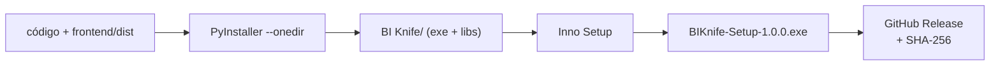

# 12 — Execução, empacotamento e distribuição

## 1. Hoje: como executar em desenvolvimento (FATO, verificado)

> O README atual **não traz** estas instruções. Elas foram reconstruídas e testadas na auditoria.

```powershell
# Windows (PowerShell), na pasta do projeto
python -m venv .venv
.\.venv\Scripts\Activate.ps1
python -m pip install -r requirements.txt
python -m uvicorn app.main:app --host 127.0.0.1 --port 8000
# abrir http://127.0.0.1:8000
```

Testes: `python -m pytest -q` (131 testes, ~15 s).

⚠️ Nunca usar `--host 0.0.0.0`: a API não tem autenticação.

## 2. Alvo: aplicativo Windows instalável



### 2.1 Launcher (`desktop/launcher.py`)
1. Limpa temporários de sessões órfãs.
2. Escolhe uma porta livre aleatória e gera um token de sessão (`secrets.token_urlsafe`).
3. Sobe o uvicorn em thread, só em `127.0.0.1`.
4. Abre a janela `pywebview` em `http://127.0.0.1:{porta}/?t={token}` (fallback: navegador padrão).
5. Ao fechar a janela: encerra o servidor, apaga os temporários e grava o log.

### 2.2 Decisões de empacotamento
| Decisão | Motivo |
|---|---|
| `--onedir` em vez de `--onefile` | Abre mais rápido e gera **muito menos falso positivo de antivírus** (o onefile extrai para `%TEMP%` a cada execução) |
| Inno Setup | Gratuito, maduro, instala por usuário (sem precisar de admin) |
| Instalação por usuário em `%LOCALAPPDATA%\Programs\BIKnife` | Não exige privilégios administrativos, o que facilita em ambiente corporativo |
| Dados de trabalho em `%LOCALAPPDATA%\BIKnife\sessions` | Separado do programa; fácil de limpar |
| Logs em `%LOCALAPPDATA%\BIKnife\logs` (rotativo, 5 × 5 MB) | Suporte sem expor dados |

### 2.3 Versões e atualizações
- **SemVer:** `MAJOR.MINOR.PATCH`; versão única definida no `pyproject.toml` e lida pela aplicação (hoje está fixa em `config.py`).
- **Atualização:** no MVP, manual (o usuário baixa o novo instalador). Pós-MVP: verificação **opt-in** de nova versão. Isso é uma conexão de rede e deve ser desligada por padrão, para não violar a premissa.
- **Assinatura de código:** recomendada antes de distribuir para empresas (certificado OV/EV). Até lá, publicar o SHA-256.

### 2.4 Matriz de teste antes de cada release
| Ambiente | Obrigatório |
|---|---|
| Windows 11 x64, usuário comum, sem Python | ✅ |
| Windows 10 22H2 x64, usuário comum, sem Python | ✅ |
| Máquina com antivírus corporativo (Defender + SmartScreen) | ✅ |
| Caminho com acentos e espaços (`C:\Users\José Silva\`) | ✅ |
| Proxy corporativo | ✅ (deve funcionar porque nada usa rede) |

### 2.5 Preparação para uso corporativo
- **Ficha de segurança de 1 página** para a TI: o que o app faz, o que **não** faz (rede, macros), onde grava, como desinstalar e como verificar (hash e testes públicos).
- Instalação silenciosa: `BIKnife-Setup.exe /VERYSILENT /CURRENTUSER`.
- Configuração por arquivo `config.toml` ao lado do executável (limites, regras desativadas), para padronizar entre usuários.
